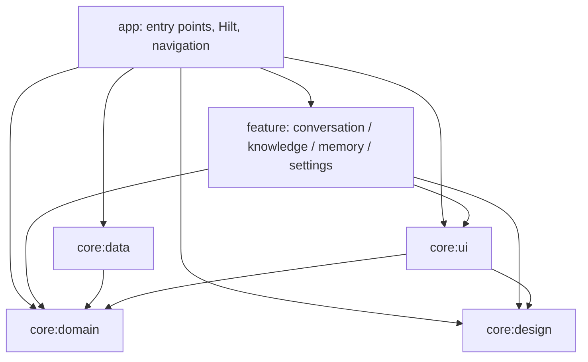

# Android architecture

The native client uses the existing TypeScript backend. Agent execution, canonical conversation persistence and external-task continuation remain server responsibilities. Android owns interaction, observation, recovery from snapshots and local drafts/admission journals.

The module organization follows the `sctv-dl` Android client: a pure domain module, Android data implementations, independent design primitives, application UI adapters and features grouped by capability. It applies Android Developers guidance for [architecture](https://developer.android.com/topic/architecture/recommendations), [repositories](https://developer.android.com/topic/architecture/data-layer), [modularization](https://developer.android.com/topic/modularization/patterns), [Hilt](https://developer.android.com/training/dependency-injection/hilt-android) and [Navigation 3 state](https://developer.android.com/guide/navigation/navigation-3/save-state), reviewed on October 11, 2026.

## Modules and dependencies

Features depend on repository interfaces and shared UI, and cannot import data implementations or transport libraries. Data implementations are internal; `RepositoryFactory` is the creation boundary bound to `RepositoryProvider` by Hilt. Features have a test-only data dependency for controlled HTTP/platform regression fixtures. Features do not depend on app or each other. A2UI remains in conversation with its workflow rendering and review lifecycle.

| Module | Responsibility and entry points |
| --- | --- |
| `app` | `MainActivity`, `PlaygroundApplication`, `di/ServerGraph`, `di/WorkspaceModels`; `navigation/` owns Navigation 3 stacks, adaptive layout, connection gating and visibility. |
| `core:domain` | Pure JVM `model/` contracts and official AG-UI serialization; `repository/` ports; `conversation/` session, history loading, reducers, admission/recovery and review policies; `presentation/` pure transformations; `settings/` and `files/` platform-free values. |
| `core:data` | `di/` Hilt bindings; `preferences/` DataStore; `conversation/` journals/repository; `knowledge/`, `memory/`, `server/` repositories; `network/` Retrofit REST, OkHttp SSE, response handling and URL normalization; `files/` ContentResolver streams. |
| `core:design` | Domain-independent Material 3 theme, components, motion, drawer and brand resources. |
| `core:ui` | Android permission bridge, saveable download adapter and composition-owned Coil image decoding. |
| `feature:conversation` | Route, Screen, ViewModel and UiState; subject packages for composer, attachments, timeline, Markdown, history, review, activity and official A2UI rendering. |
| `feature:knowledge` | Route owns picker/save launchers; Screen renders documents and dialogs; ViewModel owns uploads, retry/resume and foreground polling; UiState exposes operation state. |
| `feature:memory` | Route binds lifecycle-aware state; Screen, Row and Dialog render paginated memories and conflict review; ViewModel owns mutation/pagination; UiState owns screen/dialog contracts. |
| `feature:settings` | Hilt Route binds permissions and lifecycle; Screen renders preferences and connection state; ViewModel owns saved address/connection transactions; SettingsState defines their contract. |

Files follow responsibilities rather than a fixed size limit. Route files collect state, bind actions and manage Android launchers/effects. Screen files receive state and callbacks. ViewModels coordinate jobs and state without importing concrete repositories. State contracts live in their own files. Pure policies and projections live in domain; protocol and storage adaptation live in data.

## Libraries and dependency injection

Hilt + KSP construct the application graph and ViewModels. Preferences and the repository provider are application singletons. Conversation, knowledge and memory ViewModels use assisted injection for the runtime server URL. `ServerGraph` owns their retained ViewModel store; Hilt creates them through the standard Compose creation callback. Each remote repository transfers ownership to its ViewModel and is closed with that model. Settings receives singleton preferences/server ports and a Hilt-provided `SavedStateHandle`.

Navigation 3 supplies serializable `NavKey` destinations, `rememberNavBackStack`, entry saveable state, entry ViewModel stores, display transitions and nested/predictive back handling. Conversation, knowledge, memory and settings each retain a primary stack when switching through the drawer. Activity is pushed on the conversation stack. Back from another primary destination returns to conversation; an open drawer handles back first. Entry content keys include the normalized server so saved UI and settings models belong to that connection. Shared conversation models remain server-scoped so the activity page can observe the same running session. Navigation entry ownership does not replace the server graph's resource lifecycle.

Retrofit 3 handles REST endpoint declarations, path/query encoding, JSON conversion and cancellable suspend calls. `PlaygroundApi` retains application validation and response identity checks; `ApiResponses` preserves server error messages/statuses and snapshot 404 semantics. Downloads use Retrofit's streaming response on the IO dispatcher. SSE uses the existing OkHttp EventSource extension with bounded Flow delivery and explicit cancellation. Official AG-UI and A2UI libraries retain protocol ownership. DataStore keeps the existing preferences/journal schema; Coil owns bounded image decoding. A local relational cache and a media player are not current requirements, so Room and Media3 are not dependencies.

## State and data ownership

Routes collect ViewModel `StateFlow` with `collectAsStateWithLifecycle`. Rendering components receive state, download/image descriptors and action callbacks. Permission launchers and system document/save pickers remain at the Android UI boundary. Network transactions and DataStore writes run through repositories, outside rendering.

`ConversationSession` is the only owner of a selected thread's run state. It contains admission, streaming, snapshot reconciliation, review decisions and output sequencing; it does not depend on Android or Compose. Event reducers, review policies and presentation builders are pure transformations. `ConversationViewModel` owns session selection, screen state, operation guards and visibility. It requests journal operations through `ConversationRepository`. `ConversationHistoryLoader` coordinates pagination and coalesced refreshes without changing selection or writing journals.

`KnowledgeViewModel` owns pending upload selection, operation guards and foreground polling. `KnowledgeRepository` validates and reads local files into an opaque prepared upload, transfers admitted document IDs and exposes remote operations/download descriptors. Local preparation fails before transfer and does not trigger server reconciliation. The ViewModel reconciles ambiguous transfer responses through repository reads while preserving selected IDs and explicit retry/discard actions.

`MemoryViewModel` owns the loaded pages, correction draft and synchronous request guards. `MemoryRepository` owns management requests through the existing public API. A mutation retains its displayed revision until the user reviews a newer saved version; conflict refresh keeps the draft. Refresh reloads all previously loaded pages so page boundaries stay consistent. Successful writes update local state before reconciliation, preserving their result if the subsequent read fails. Opening the page refreshes its data; memory capture and recall remain server responsibilities.

`SettingsViewModel` owns the address draft and connection transaction. The route handles permissions, `ServerRepository` performs the health/model check with a transaction-scoped client, and `PreferencesRepository` updates only the requested fields against the latest DataStore value. A delayed connection check therefore preserves concurrent theme and keyboard edits. Leaving settings cancels its pending connection check.

## Lifetimes and recovery guarantees

`ServerGraph` is retained by the Activity. Recreating the Activity reuses its server-scoped ViewModels. Replacing the normalized server address clears the previous ViewModel store; clearing a ViewModel closes its history/session/repository resources. Closing `ConversationRepository` releases its HTTP client; closing `KnowledgeRepository` or `MemoryRepository` releases its HTTP client. A session owns its coroutine lifetime but borrows the repository's transport, so switching threads closes the old session without closing the server's repository. UI visibility uses AndroidX lifecycle effects; leaving the app stops observation without cancelling the backend run.

Each thread's draft and pending submission are persisted under its normalized server URL. The original run/message IDs are saved before POST. Unobserved or server-prepared admissions retry that exact payload; dispatched/running/unknown admissions wait for canonical checkpoints. Snapshot reconciliation protects newer streamed events and terminal state. Admission stays locked through journal persistence and stream settlement. Workflow outputs apply in contiguous sequence order and retain conflicting-duplicate and missing-predecessor gates. The official A2UI processor continues to own protocol validation, components and dynamic bindings.

`ConversationSession` also owns model selection and its journal/snapshot ordering. New threads save an unsent choice locally; existing threads save through the server's guarded selection endpoint. Metadata catalogs belong to screen state, while the selected model belongs to the session. Pending requests preserve their model across retries, and the picker receives state/callbacks with upload and run guards. See [model selection](model-selection.md) for provider configuration and run inheritance.

File transfers use the Storage Access Framework and bounded reads. Selected attachments and unfinished upload queues survive configuration changes through their ViewModels; after process restart, an uploading server document can resume with its original ID after reselecting the original file. Ambiguous upload failures preserve selected admission identities for retry. Downloads and remote previews continue through transport origin validation and cancellation. Image decoding has a 16 MiB memory cache with disk caching disabled; data exposes remote bytes, and `core:ui` decodes them through Coil into Compose image values. The decoder is closed when its composition leaves or its server changes.

## Verification and maintenance

Tests live with their module's implementation. Domain tests cover JVM contracts, session/recovery, history coordination and presentation. Data tests cover REST/SSE, files and persistent journals; UI tests cover decoding and permission classification. Feature tests cover Compose rendering, ViewModels, upload recovery and controlled HTTP/SSE flows. App tests cover cross-feature navigation, connection gating and retained resource lifetimes.

The root `spotlessApply`/`spotlessCheck` targets every maintained Kotlin source, test and Gradle Kotlin script. `lintCheck` runs lint for all nine modules, including tests, with warnings treated as errors. `qualityCheck` runs formatting, lint, all JVM/Robolectric tests and both app builds. `architectureCheck` enforces module edges, JVM purity and feature/data boundaries. SDK, Java, Compose, Hilt/KSP, test-resource and lint configuration is shared by convention plugins in `build-logic/`; module-specific dependencies and namespaces remain local. CI executes the same gate and collects reports from every module.

These controlled tests do not establish live-device or live-model compatibility. See the [Android client guide](../android/README.md) for setup, user behavior, operating limits and device verification.
