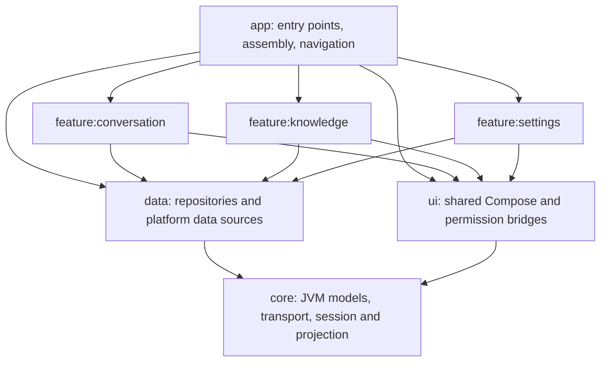

# Android architecture

The native client uses the existing TypeScript backend. Agent execution, canonical conversation persistence and external-task continuation remain server responsibilities. The Android client owns interaction, observation, recovery from server snapshots and local drafts/admission journals.

The structure follows the current Android Developers guidance for [layered architecture](https://developer.android.com/topic/architecture/recommendations), [repository data access](https://developer.android.com/topic/architecture/data-layer), [UI state](https://developer.android.com/topic/architecture/ui-layer) and [module boundaries](https://developer.android.com/topic/modularization/patterns), reviewed on October 7, 2026. The optional domain/use-case layer is unnecessary for the present client: shared run logic already has a single JVM owner, and each screen uses its own repository. Constructor injection and AndroidX ViewModel factories keep dependency creation explicit.

## Modules and dependencies

`data` exports JVM core contracts used in repository and session APIs. Feature production dependencies use the repositories and shared UI; the app creates concrete transport/platform resources. Features do not depend on the app or one another. A2UI belongs to conversation because it renders conversation-owned workflow output and shares that feature's review/presentation lifecycle. The existing JVM core stays one module, organized into cohesive packages rather than several small build targets.

| Module                 | Responsibility and package entry points                                                                                                                                                                                                                                                                    |
| ---------------------- | ---------------------------------------------------------------------------------------------------------------------------------------------------------------------------------------------------------------------------------------------------------------------------------------------------------- |
| `app`                  | `MainActivity` and `PlaygroundApplication`; `di/ServerGraph` builds server-scoped resources; `navigation/` composes destinations, connection gating and visible observation.                                                                                                                               |
| `core`                 | `model/` holds application REST/journal/file contracts and official AG-UI serialization; `network/` holds OkHttp HTTP/SSE and server-address validation; `conversation/` holds the session, reducers, admission/recovery and review policies; `presentation/` holds pure message/activity transformations. |
| `data`                 | `PreferencesRepository` provides atomic preferences and normalized-server journals. `conversation/`, `knowledge/` and `server/` own remote/local transactions. `files/` owns document-provider streams and bounded image decoding.                                                                         |
| `ui`                   | Shared Material 3 theme, motion, drawer, components and brand resources; `DownloadSaver` adapts a download descriptor to saved UI state; `network/` owns system local-network permission interaction.                                                                                                      |
| `feature:conversation` | Public `ConversationRoute`, `ConversationHistoryRoute`, `ActivityScreen` and `ConversationViewModel`. Internal UI packages separate composer, attachments, timeline, Markdown, history, review, activity and official A2UI workflow rendering.                                                             |
| `feature:knowledge`    | `KnowledgeRoute` and `KnowledgeViewModel` expose document operation/status state, polling, retry/resume and system picker/save interactions.                                                                                                                                                               |
| `feature:settings`     | `SettingsRoute` binds saved address state, permission results, connection checking and preference actions through its ViewModel and repositories.                                                                                                                                                          |

## State and data ownership

Routes collect ViewModel `StateFlow` with `collectAsStateWithLifecycle`. Rendering components receive state, download/image descriptors and action callbacks. Permission launchers and system document/save pickers remain at the Android UI boundary. Network transactions and DataStore writes run through repositories, outside rendering.

`ConversationSession` is the only owner of a selected thread's run state. It contains admission, streaming, snapshot reconciliation, review decisions and output sequencing; it does not depend on Android or Compose. Event reducers, review policies and presentation builders are pure transformations. `ConversationViewModel` owns session selection, screen state, operation guards and visibility. It requests journal operations through `ConversationRepository`. `ConversationHistoryRepository` coordinates pagination and coalesced refreshes without changing selection or writing journals.

`KnowledgeViewModel` owns pending upload selection, operation guards and foreground polling. `KnowledgeRepository` validates and reads local files into an opaque prepared upload, transfers admitted document IDs and exposes remote operations/download descriptors. Local preparation fails before transfer and does not trigger server reconciliation. The ViewModel reconciles ambiguous transfer responses through repository reads while preserving selected IDs and explicit retry/discard actions.

`SettingsViewModel` owns the address draft and connection transaction. The route handles permissions, `ServerRepository` performs the health/model check with a transaction-scoped client, and `PreferencesRepository` updates only the requested fields against the latest DataStore value. A delayed connection check therefore preserves concurrent theme and keyboard edits. Leaving settings cancels its pending connection check.

## Lifetimes and recovery guarantees

`ServerGraph` is retained by the Activity. Recreating the Activity reuses its server-scoped ViewModels. Replacing the normalized server address clears the previous ViewModel store; clearing a ViewModel closes its history/session/repository resources. Closing `ConversationRepository` releases its image decoder and HTTP client; closing `KnowledgeRepository` releases its HTTP client. A session owns its coroutine lifetime but borrows the repository's transport, so switching threads closes the old session without closing the server's repository. UI visibility uses AndroidX lifecycle effects; leaving the app stops observation without cancelling the backend run.

Each thread's draft and pending submission are persisted under its normalized server URL. The original run/message IDs are saved before POST. Unobserved or server-prepared admissions retry that exact payload; dispatched/running/unknown admissions wait for canonical checkpoints. Snapshot reconciliation protects newer streamed events and terminal state. Admission stays locked through journal persistence and stream settlement. Workflow outputs apply in contiguous sequence order and retain conflicting-duplicate and missing-predecessor gates. The official A2UI processor continues to own protocol validation, components and dynamic bindings.

`ConversationSession` also owns model selection and its journal/snapshot ordering. New threads save an unsent choice locally; existing threads save through the server's guarded selection endpoint. Metadata catalogs belong to screen state, while the selected model belongs to the session. Pending requests preserve their model across retries, and the picker receives state/callbacks with upload and run guards. See [model selection](model-selection.md) for provider configuration and run inheritance.

File transfers use the Storage Access Framework and bounded reads. Selected attachments and unfinished upload queues survive configuration changes through their ViewModels; after process restart, an uploading server document can resume with its original ID after reselecting the original file. Ambiguous upload failures preserve selected admission identities for retry. Downloads and remote previews continue through transport origin validation and cancellation. Image decoding has a 16 MiB memory cache with disk caching disabled; data returns Android bitmaps and the conversation feature adapts them to Compose image values.

## Verification and maintenance

Tests live with their module's implementation. Core tests cover JVM protocol/session/transport/presentation behavior. Data tests cover platform decoding and history coordination. Feature tests cover Compose rendering, ViewModels, upload recovery and controlled HTTP/SSE flows. App tests cover cross-feature navigation, connection gating and retained resource lifetimes.

The root `spotlessApply`/`spotlessCheck` targets every maintained Kotlin source, test and Gradle Kotlin script. `lintCheck` runs lint for all seven modules, including tests, with warnings treated as errors. `qualityCheck` runs formatting, lint, all JVM/Robolectric tests and both app builds. Android library SDK, Java, test-resource and lint configuration is shared at the root; module-specific dependencies and namespaces remain local. CI executes the same gate and collects reports from every module.

These controlled tests do not establish live-device or live-model compatibility. See the [Android client guide](../android/README.md) for setup, user behavior, operating limits and device verification.
