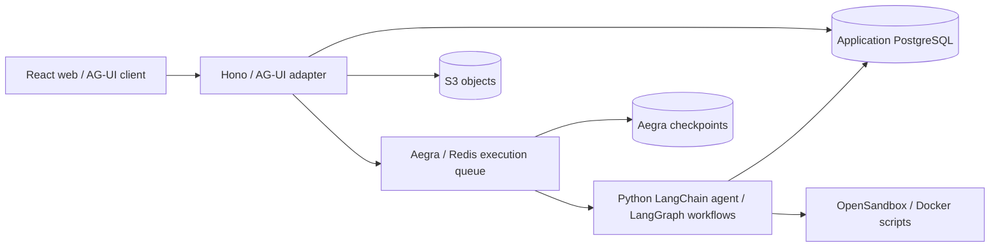

# Architecture

[Documentation index](README.md) · [Frontend architecture](frontend-architecture.md)

## Execution path

The server uses the official `@ag-ui/langgraph` adapter to create native Aegra runs. Aegra owns execution scheduling and thread concurrency; the Hono server owns application admission, recovery and the browser's HTTP/SSE transport. A browser disconnect detaches its stream without cancelling the server-owned run.

## Code boundaries

| Area                                                                 | Responsibility                                                                                             |
| -------------------------------------------------------------------- | ---------------------------------------------------------------------------------------------------------- |
| `agent_playground/graph.py`, `config.py`, `prompts.py`, `context.py` | Agent/model/tools, shared Python configuration and checkpointed model context.                             |
| `agent_playground/workflows/`                                        | Experiment, SQL and report graphs/tools/cards; common review, external wait and output publication.        |
| `agent_playground/services/`                                         | SQL/report demonstration APIs; depend on configuration and repositories rather than workflows.             |
| `agent_playground/skills/`                                           | Bundle catalog, script execution and authenticated file transfers.                                         |
| `agent_playground/knowledge/`                                        | Text extraction, durable indexing, embedding/pgvector clients and retrieval tool.                          |
| `agent_playground/db/`                                               | Python database contracts, connections and repositories, independent of HTTP.                              |
| `server/http/`                                                       | Routes, request validation and conversation-change SSE.                                                    |
| `server/agent/`                                                      | Shared Aegra client, official protocol adapter and stream transport.                                       |
| `server/conversation/`                                               | Admission, run mapping/state, recovery, task continuation, snapshots and conversation files.               |
| `server/knowledge/`, `server/storage/`                               | Document lifecycle/cleanup and shared S3 client.                                                           |
| `server/db/`, `server/drizzle/`                                      | Application database schemas, access and migrations.                                                       |
| `server/app.ts`, `server/server.ts`                                  | HTTP assembly and process/resource lifecycle respectively.                                                 |
| `web/src/app/`, `web/src/pages/`                                     | Routing/providers and page composition.                                                                    |
| `web/src/features/conversation/`, `knowledge/`, `a2ui/`              | Chat/session UI, shared document management and official A2UI processing/catalog.                          |
| `shared/`                                                            | Application contracts: runs, context, conversations, workflow outputs/reviews, tasks, files and knowledge. |

AG-UI and A2UI protocol schemas remain owned by the official libraries. SQL workflows reuse API response models from `services/sql/models.py`; their revision output and business state remain in `workflows/sql/models.py`. `http.py` registers services and owns the report and knowledge worker lifecycles.

## State and storage

| State                                                 | Source of truth                                           |
| ----------------------------------------------------- | --------------------------------------------------------- |
| Model history, workflow state and pending interrupts  | Aegra/LangGraph checkpoint.                               |
| Public transcript and run summaries                   | Application conversation tables.                          |
| Published cards/replies and their output sequence     | Application `workflow_outputs`.                           |
| Document index jobs, generations and visible chunks   | Application metadata and pgvector tables.                 |
| File bytes                                            | S3; application tables keep metadata and lifecycle state. |
| Local draft, presentation pacing and open UI controls | Browser/session state.                                    |

Model compaction replaces checkpoint history with a summary while preserving the application's public transcript. A normal browser submission sends the newest user message, without replaying archived history back into model context. Conversation snapshots restore saved messages, outputs, tasks and context usage; they are not durable AG-UI event replay.

See [development](development.md#database-and-data-ownership) for schema roles and migrations, [conversations](conversations.md) for visible behavior and [workflows](workflow-mechanisms.md) for business-state and review contracts.

## Admission and recovery consistency

Admission checks the newest run under the conversation lock. An identical submission is recognized before validating a new review, allowing a prepared review to be retried after restart. Run updates are conditional on the mapping/state originally observed; a late callback or older upstream response cannot reopen a terminal run or overwrite a newer mapping.

The server synchronizes the latest run before reading a snapshot. Completed and interrupted checkpoints have a durable synchronization marker, including interrupts; later reads use saved messages and outputs without re-fetching that checkpoint. Message IDs are inserted in a batch with explicit checkpoint order.

If run creation was accepted upstream but its mapping is unconfirmed, recovery examines only the newest native Aegra run for the thread. It never blindly creates another execution or walks historical runs. A mapping that cannot be confirmed stays `submission_unknown` until later recovery or manual reconciliation.

In the web app, TanStack Query owns fetching/caching; the conversation session owns reconciliation and SDK/A2UI resources. Each completed fetch is delivered once. Active local submission/stream state is preserved while a snapshot still lacks a confirmed upstream mapping. Idle conversations and healthy streams do not poll; temporary polling handles recovery. See [frontend architecture](frontend-architecture.md#state-and-resources).

## A2UI output and presentation

Python saves each output before emitting an AG-UI `CUSTOM` event named `a2ui`. The application envelope carries its stable ID, `outputSeq`, run/tool ownership and the official `messages` array. Optional `workflow.reply` and `workflow.presentation` metadata describe public replies and card placement outside the business component schema.

The server forwards live events and includes saved outputs in conversation snapshots. One official `MessageProcessor` per conversation consumes them in `outputSeq` order, deduplicates outputs and supports multiple surfaces, component/data updates, dynamic string bindings and deletion. Sequence gaps trigger snapshot recovery. Conflicting or malformed output surfaces an error; because the processor cannot roll back a failed batch, affected surfaces are hidden and further processing stops for that session.

The current output format is version 3. Legacy `kind: "a2ui"` wrappers, `experiment_card` events, Basic Catalog surfaces and old SQL review formats are unsupported. Old database rows remain; start a current-format conversation rather than interpreting the historical formats as supported behavior. Review submission uses the separate review contract; A2UI actions are not wired to backend execution.

## Current boundaries

- The application is one shared workspace without per-user authentication or tenant ownership.
- Snapshots recover persisted results; live AG-UI events have no durable replay log.
- Workflow definitions are Python/LangGraph code, with business-specific checks and submission semantics.
- SQL/report services are demonstrations. SQL checks and accepted receipts do not execute SQL.
- Docker Skills and exact vector retrieval are a first implementation, with their limits in [Skills](skills.md) and [knowledge](knowledge.md).

The [dated recovery validation record](conversation-recovery-validation.md) records earlier checks and their limits; current contracts are described in this guide and the capability guides.
