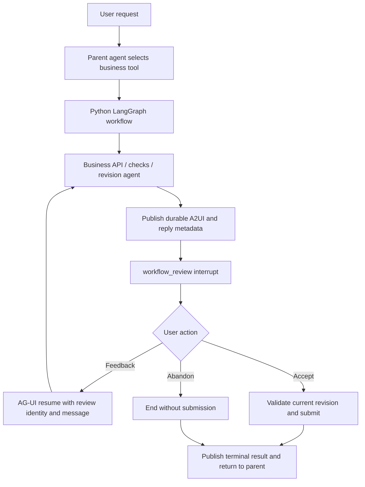
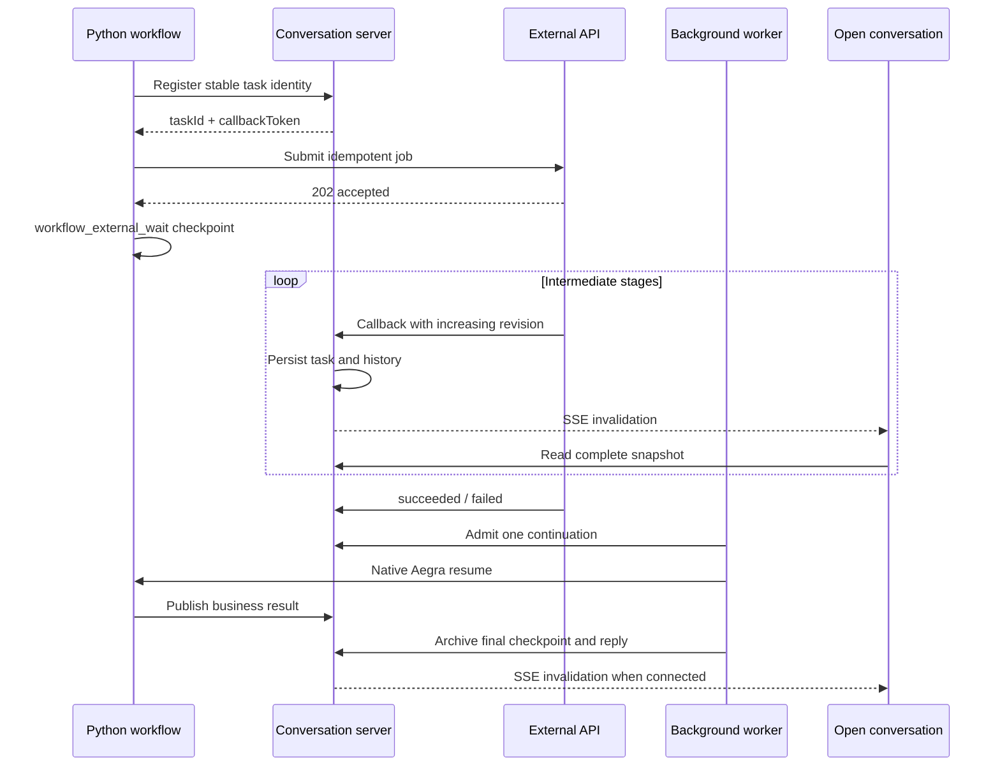

# Workflows and shared mechanisms

[Documentation index](README.md) · [Architecture](architecture.md) · [Conversations and recovery](conversations.md)

## Built-in examples

| Tool                      | Start                                                                                                    | Review or result                                                                                                                |
| ------------------------- | -------------------------------------------------------------------------------------------------------- | ------------------------------------------------------------------------------------------------------------------------------- |
| `run_experiment_workflow` | Send **"Create an experiment plan for testing an agent workflow."**                                      | Edit the plan and choose **Approve plan** or **Reject**; decide each parallel plan before **Continue workflow**.                |
| `run_sql_workflow`        | Choose **Review SQL**, or send **"Use run_sql_workflow to calculate monthly revenue from paid orders."** | Request SQL changes/explanations in chat. **Accept and submit** requires a passing check; **Abandon** ends without submission.  |
| `run_report_workflow`     | Choose **Generate report** and send; specify `outcome="failed"` to test failure.                         | About 12 seconds of simulated progress; background continuation completes without an open page, and reopening restores results. |
| `run_a2a_workflow`        | Choose **Collaborate with agents** and send; use `require_input=True` for an additional-input example.   | Planner, reviewer and revision output stream live; input/cancel and recovery are described in the [A2A guide](a2a-demo.md).     |

Welcome actions prepare editable messages; sending starts execution. Experiment plans show the current card, retaining earlier steps in tool history. Review results replace the editor in the original reply and survive reload.

If initial SQL checking fails, the agent proposes one revision and rechecks before pausing. Changes increment the revision and require another check; explanations keep the revision/check. Each review is persisted independently, restoring the latest SQL, checks, discussion and decision. Multiple pending reviews require explicit decisions; the composer accepts feedback only for one unambiguous SQL conversational review.

## Demonstration service boundaries

`/sql-demo/generate` starts with `SELECT * FROM orders;` and demo schema `orders(id, customer_id, created_at, status, amount)`, then the model adapts it to the request. `/sql-demo/check` uses sqlglot to check a single SELECT, explicit columns and the demo schema. It does not execute SQL against PostgreSQL or establish semantics, query plans or performance.

Queries exceeding the parser's nesting complexity return a failed check with an issue, rather than an unhandled server error. Submission applies the same validation boundary.

`/sql-demo/submit` rechecks accepted SQL and stores an idempotent receipt. Keys contain the conversation, workflow call and accepted revision. `/sql-demo/submissions/:id` recovers receipts after transport failure. The SQL revision model locally disables DeepSeek thinking for forced structured-output tool choice; parent chat configuration stays independent.

The report API persists simulated jobs/callback offsets, progressing through queued, preparing, processing, finalizing and completed stages. Restart resumes delivery; `404` for a deleted task stops callbacks. These APIs demonstrate workflow mechanisms rather than production SQL execution or reporting.

`services.sql_demo_url` and `services.report_demo_url` in `agent.yaml` configure the demonstration APIs. `workflow.app_api_url` targets the TypeScript server, and `workflow.api_token` matches `WORKFLOW_API_TOKEN` in `server/.env`. Defaults are in [development configuration](development.md#configuration-ownership).

## Workflow execution

Python/LangGraph defines sequence, branches and business state. Shared mechanisms handle review, recovery and presentation; SQL and asynchronous reporting are business examples.

## Code responsibilities

| Code                                     | Responsibility                                                                                                     |
| ---------------------------------------- | ------------------------------------------------------------------------------------------------------------------ |
| `agent_playground/graph.py`              | Parent agent graph and tool assembly; `context.py` and `context_state.py` own compaction and checkpoint contracts. |
| `agent_playground/workflows/review.py`   | `WorkflowReview` / `wait_for_review()`: pause, feedback/accept/abandon, identity and acceptance checks.            |
| `agent_playground/workflows/output.py`   | Persist before events; publish official A2UI and independent reply/presentation metadata.                          |
| `agent_playground/workflows/sql/`        | SQL generation, checking, revisions, submission, receipts, model adaptation and content display.                   |
| `agent_playground/workflows/experiment/` | Experiment stages and editable form review.                                                                        |
| `agent_playground/services/sql/`         | API models/routes/checks; persist submissions without executing SQL.                                               |
| `agent_playground/services/report/`      | Report requests, stages and durable callback delivery.                                                             |
| `agent_playground/db/`                   | Database contracts and idempotent persistence, independent of HTTP/review copy.                                    |
| `shared/workflow-review.ts`              | Common review identities/responses without SQL, schema or check fields.                                            |
| `shared/workflow-output.ts`              | Stable reply IDs and presentation ownership without parsing business cards.                                        |
| `server/src/conversation/`               | Admission, review/output checks, feedback archiving and checkpoint reply synchronization.                          |
| `server/src/agent/`                      | Official AG-UI/LangGraph adapter and resume targeting by interrupt ID.                                             |
| `web/src/features/conversation/`         | Common feedback routing, decision panels and current/historical card presentation.                                 |
| `web/src/features/a2ui/`                 | Official processor and business components; does not authorize business submission.                                |

Services depend on `config/`, pure `services/a2a/contracts.py` and `db/`, not workflow orchestration. SQL API models live in `services/sql/models.py`; workflow clients/state reuse them. Review state and revision-agent output remain in `workflows/sql/models.py`. A2A workflow state and completion cards live in its `models.py` and `cards.py`. Each business graph is defined in `workflows/<domain>/graph.py`. `app.py` assembles routes and owns the report, knowledge and A2A workers.

## State, review identity and acceptance

LangGraph checkpoints own business state, versions and pending interrupts. Application `workflow_outputs` owns published display/replies, assigning conversation `outputSeq` before sending events. `conversation_messages` owns user feedback and the public transcript; synchronization deduplicates stable reply IDs shared by realtime and recovered views.

`workflow_review` carries the call ID, content `revision`, interaction `round` and persisted `outputStepId`. Content changes increment revision; each publication/wait increments round. Explanations may preserve content/checks, but buttons from a previous round are stale.

The business graph computes `canAccept`. Server and frontend enforce the current interrupt's gate; Python validates again on resume. Business nodes own actual submission, and user responses cannot override acceptance eligibility.

The composer sends feedback resume only for a single conversational review. Multiple reviews or mixed form reviews require explicit decisions rather than a guessed feedback target.

## Outputs and business cards

An output may contain official A2UI `messages` and application `workflow` metadata. `workflow.reply` contains a stable ID/public assistant content. `workflow.presentation` specifies surface ID, group ID and the reply anchoring that card. These fields do not go to the A2UI processor.

A later complete surface in the same group replaces its current presentation, retaining prior surfaces in the original tool's history. Each round uses an independent surface ID; reply ownership keeps the latest card beside the feedback reply, without moving it to an unrelated turn. Unowned output stays visible. One output currently describes one reply and one grouped surface; other A2UI surfaces use normal tool ownership.

Business components can display SQL, writing, configuration or other content. Conversation archiving does not depend on component types, tool names or business fields. Reply metadata provides archiving rather than business cards.

Old SQL interrupt/card formats are unsupported; remove old conversations through the application. Repeated output for the same step uses strict payload equality: identical current-format publication preserves identity/sequence, and conflicting content is rejected.

## Adding another business workflow

1. Implement a LangGraph with its own state, APIs, check/revision nodes and business tool. Keep model prompts and structured-output adaptation within that business.
2. Publish content with A2UI and `WorkflowOutputMetadata`, using stable step/reply IDs and independent surface IDs per round.
3. Call `wait_for_review(WorkflowReview(...))` in a separate wait node. Supply current identity, `canAccept`, action copy and input hints, routing message/accept/abandon to business nodes.
4. Increment revision and recheck changed content. Business APIs own idempotency and unknown-outcome recovery.

Reusing components requires no server/frontend conversation changes. Add a component/catalog entry only for specialized display. Experiment's editable form remains a separate supported interaction.

The common mechanism does not implement a workflow DSL, arbitrary action interpretation, automatic selection among pending reviews or business validation.

## External tasks

Tasks belong to a conversation, workflow call and step. The Python helper derives a stable task ID from that identity; registration requires an existing run in a conversation that has not been deleted. Repeated registration returns the same callback credential, while conflicting identity or labels are rejected.

The shared layer stores current task state, revision, business stage/message/progress and history. Intermediate updates affect display without invoking the agent. For terminal results, the worker matches `workflow_external_wait` and creates native Aegra continuation through existing admission/recovery. This works without an open browser. Early callbacks remain persisted until the checkpoint is ready.

External APIs post complete snapshots. Duplicate/older revisions are ignored; same-revision conflicts and terminal regressions are rejected. Each callback token is task-specific and excluded from public snapshots. Registration uses the matching internal token from Python/server environment. Trusted backend resume supplies results; user review requests cannot fabricate external terminal states.

| Endpoint                              | Credentials and payload                                                                                        |
| ------------------------------------- | -------------------------------------------------------------------------------------------------------------- |
| `POST /internal/external-tasks`       | `Authorization: Bearer <WORKFLOW_API_TOKEN>`; register stable identity before submitting to a trusted service. |
| `POST /external-tasks/:taskId/events` | Task callback token; `{revision, status, stage, message, progress?, result?, error?}` snapshot.                |

Status is `queued`, `running`, `succeeded` or `failed`. Success requires an object result; failure requires an error. Same-revision conflicts or changes after terminal state return `409`. The server scans persistent tasks every second and admits continuation under the conversation lock, using bounded mapping recovery for unknown run creation.

`workflows/external.py` supplies registration and a separate wait node. `shared/external-task.ts` defines cross-layer state/interrupt contracts. `server/src/conversation/tasks/task-store.ts` persists updates; `server/src/conversation/tasks/task-worker.ts` continues runs; `server/src/conversation/events/publish.ts` publishes notifications. `server/src/conversation/events/subscription.ts` shares one PostgreSQL LISTEN connection across the process's active SSE subscribers, and `server/src/routes/conversation-events.ts` owns each stream. Query fetches snapshots, session coordinates updates and `ExternalTaskPanel` presents progress/history. HTTP modules own routes/validation; conversation owns persistence/continuation.

Notifications become visible after commit. Task, run, message and output changes invalidate snapshots; SSE reconnect sends `ready` and refetches complete state. Lost notifications do not lose persisted results. Switching/closing releases subscriptions. The background worker owns an Aegra client with 10-second request deadlines and aborts requests on shutdown; these are transport limits, not external-job deadlines. The server process owns the continuation worker, and Python lifespan owns demo callback delivery.

The shared listener closes after its last subscriber or application shutdown. After application shutdown starts, late requests cannot reopen it. A database connection failure closes affected SSE streams; reconnecting clients open a new listener and refetch after `ready`. Continuation scans exclude synchronized finished history in SQL, traverse active tasks in pages of 100 and share initial checkpoint synchronization for tasks on the same thread during each pass.

The report example submits, waits and publishes through `workflows/report/`. `services/report/` produces five callback stages, and `db/report_jobs.py` stores stable job identity/delivered revision. Idempotent submission does not duplicate jobs; restart continues the saved offset. Another API can reuse task persistence, continuation and display by replacing business submission/result interpretation.

Report registration is checkpointed before submission. `workflows/report/api.py` checks for an existing receipt before writing, reconciles a lost response through `GET /report-demo/jobs/{id}`, authenticated with the task's callback credential, and when needed replays the same job ID and request. A definite rejection publishes a failed task result only when no earlier write remains unconfirmed. If both submission and lookup remain unavailable, the graph raises with registration preserved; replay of the original checkpoint retries submission with that identity. It does not enter an external wait for an unconfirmed job.

Internal application routes use the shared Hono Bearer middleware with `WORKFLOW_API_TOKEN`; missing, malformed and incorrect credentials retain JSON `401` responses. Task callbacks continue to verify their separate task-specific credentials and update revisions.

External wait currently blocks another user turn in the same conversation. Active cancellation and automatic task timeouts are not implemented. External APIs must provide idempotent job creation. Unknown Aegra creation uses mapping recovery rather than claiming cross-system exactly-once execution. Deleting a conversation prevents callbacks/new continuation without revoking jobs already accepted externally.
