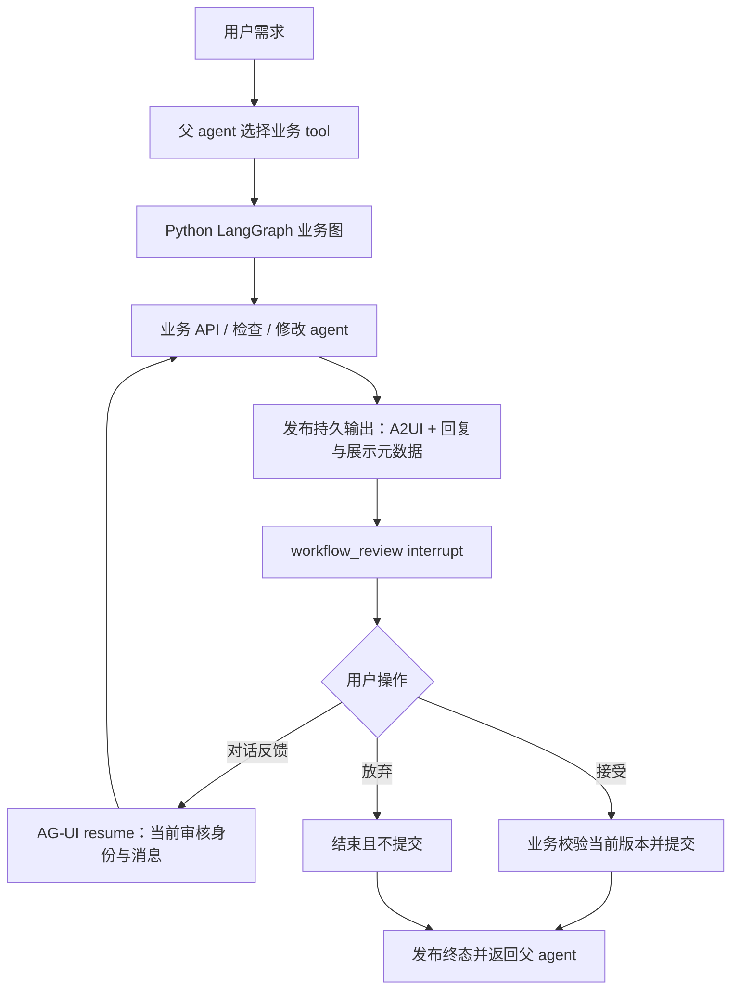
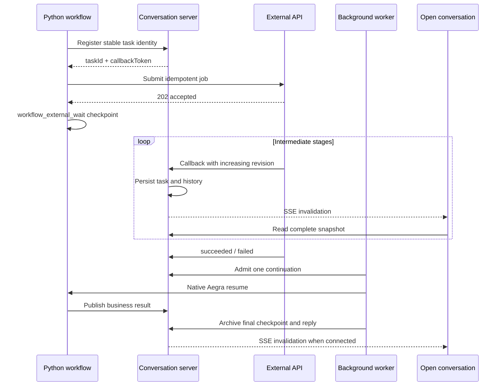

# Workflow 代码与机制

## 一条业务流程如何运行

workflow 的顺序、分支和业务状态由 Python/LangGraph 定义。通用机制处理审核、恢复和展示；SQL 和异步报告是业务示例。

## 代码职责

| 代码                                     | 职责                                                                                |
| ---------------------------------------- | ----------------------------------------------------------------------------------- |
| `agent_playground/graph.py`              | 装配父 agent、模型、tools 和上下文管理。                                            |
| `agent_playground/workflows/review.py`   | `WorkflowReview` 与 `wait_for_review()`：暂停、反馈/接受/放弃、身份和接受门槛校验。 |
| `agent_playground/workflows/output.py`   | 先持久化、后发事件；发布官方 A2UI 消息与独立的回复/展示元数据。                     |
| `agent_playground/workflows/sql/`        | SQL 获取、检查、修改、提交、回执、模型适配和 SQL 内容展示。                         |
| `agent_playground/workflows/experiment/` | 实验计划步骤和原有表单审核，继续保持其业务交互。                                    |
| `agent_playground/sql_demo/`             | 本地 SQL 模拟服务，保存提交而不执行 SQL。                                           |
| `agent_playground/db/`                   | 数据库契约和幂等持久化；不处理 HTTP 或审核文案。                                    |
| `shared/workflow-review.ts`              | 跨层的对话审核契约与响应构造，不含 SQL、schema 或 SQL 检查字段。                    |
| `shared/workflow-output.ts`              | 稳定回复 ID 与展示归属契约，不解析业务卡片。                                        |
| `server/conversation/`                   | 当前 run 的准入、审核身份与持久输出校验、用户反馈归档、checkpoint 回复同步。        |
| `server/agent/`                          | 官方 AG-UI/LangGraph adapter，resume 按 interrupt ID 定向传递。                     |
| `web/.../conversation/`                  | 按通用审核路由反馈；通用决策面板；按展示元数据组织当前卡片和历史。                  |
| `web/.../a2ui/`                          | 官方 A2UI processor 和业务组件；不决定业务能否提交。                                |

## 三份数据各有一个事实来源

LangGraph checkpoint 保存业务状态、版本和等待中的 interrupt。应用的 `workflow_outputs` 保存已发布的展示与回复，先分配会话内 outputSeq 再发实时事件。`conversation_messages` 保存用户反馈和公共对话 transcript：服务端同步回复并按稳定 ID 去重，刷新与实时展示使用同一个回复身份。

`workflow_review` 携带 workflow 调用 ID、内容 revision、交互 round 和已经持久化的 outputStepId。revision 在内容变化时递增；round 在每次发布/等待时递增。只解释时 revision 和检查结果可以不变，但旧按钮的 round 已经过期。

接受门槛由业务 graph 计算为 `canAccept`。服务端和前端用当前 interrupt 的门槛阻止不允许的动作，Python 恢复时再校验；实际提交仍由业务节点负责。用户不能通过响应覆盖业务门槛。

只有唯一一个对话审核等待时，composer 才把输入作为 feedback resume。多个审核或混合表单审核时先用显式决策面板选择，不自动猜测反馈目标。

## 输出与业务卡片分开

一个输出可以同时包含官方 A2UI `messages` 和应用 envelope 的 `workflow` 元数据。`workflow.reply` 是稳定 ID 与公共 assistant 内容；`workflow.presentation` 指定 surface ID、分组 ID，以及卡片跟随的回复 ID。这些字段不传给 A2UI processor。

同一个 group 的后续完整 surface 替换当前展示，先前 surface 留在原始 tool 的历史里。每轮发布使用独立 surface ID；reply ID 可把最新卡片锚定到用户反馈后的回复，而不会随着下一条无关消息移动。没有归属的输出保持可见。单次输出目前描述一个回复和一个分组 surface；其余 A2UI surface 使用普通 tool 归属。

业务组件可以是 SQL、文案、配置或其他内容。会话归档不依赖组件类型、工具名称或其业务字段。回复从独立元数据读取，业务卡片不再提供归档字段。

旧 SQL interrupt 和卡片格式不再支持，已有旧会话通过应用删除接口清理。持久层对同一步输出的 payload 使用严格相等比较；当前格式的重复发布仍复用原输出身份和序号。

## 接入另一种业务

1. 用自己的 state、API、检查/修改节点编写 LangGraph，并注册业务 tool；模型 prompt 与结构化输出适配留在业务内。
2. 用现有 A2UI 组件发布业务内容，同时提供 `WorkflowOutputMetadata`。每轮采用稳定的 step ID、回复 ID 和独立 surface ID。
3. 在独立等待节点调用 `wait_for_review(WorkflowReview(...))`。给出当前身份、canAccept、按钮文案和输入提示，把返回的 message/accept/abandon 路由到业务节点。
4. 内容变更后更新 revision 并重新检查；提交 API 的幂等与未知结果恢复仍属于该业务。

复用已有 A2UI 组件时无需改服务端或前端会话层。需要专门展示时只新增业务组件及 catalog 注册。实验计划的可编辑表单是另一种业务交互，不强制改成对话审核。

当前机制不负责通用 workflow DSL、任意业务动作解释、自动挑选多个审核的目标，也不代替业务检查。这些能力需要明确需求后再演进。

## 外部异步任务

通用层保存任务最新状态、revision、业务 stage/message/progress 与历史。中间状态只更新展示，不唤醒 agent。终态由后台 worker 匹配当前 `workflow_external_wait`，通过现有 run 准入和恢复机制创建原生 Aegra continuation；用户页面是否打开不影响运行。提前到达的回调先持久化，等 checkpoint 就绪后处理。

外部 API 每次回传完整状态快照。重复和旧 revision 被忽略；同 revision 内容冲突、终态回退被拒绝。callbackToken 仅用于该任务，公开快照不带它；注册使用 Python 与服务端各自环境中的同一内部 token。任务结果通过可信后台 resume 传递，普通用户审核接口不能伪造外部终态。

`workflows/external.py` 提供注册与独立等待节点；`shared/external-task.ts` 提供跨层状态和 interrupt 契约；`server/conversation/external-tasks.ts` 持久化更新与查询；`external-task-worker.ts` 负责后台续跑；`changes.ts` 负责数据库通知，`server/http/conversation-events.ts` 通过 PostgreSQL LISTEN 和 SSE 通知前端刷新。Query 仍然负责取数，session 负责协调较新快照，`ExternalTaskPanel` 展示通用进度与历史。`server/http/` 组织路由和 HTTP 校验，`app.ts` 只装配应用；业务持久化和续跑仍由 conversation 层负责。

通知在事务提交后可见；任务、run、消息和持久输出的更新会使快照失效。SSE 重连先发 ready，前端重新读取完整状态；通知丢失不影响持久结果。切换或关闭会话释放订阅连接。后台 worker 持有独立 Aegra client，单次请求限时 10 秒，停止时 abort 在途请求；这些是传输生命周期限制，不改变外部业务任务的耗时。后台 worker 由服务进程创建和释放，模拟报告回调 worker 由 Python lifespan 管理。

报告示例是独立业务：`workflows/report/` 提交、等待、发布，`report_demo/` 产生五阶段回调，`db/report_jobs.py` 保存 job 身份和已投递 revision。模拟 job 使用稳定身份重复提交不重复创建；重启按已提交偏移继续。替换为其他 API 时，修改业务提交和结果解释即可复用任务状态、续跑及实时展示。

当前等待期间不接收同一会话的新用户 turn，没有主动取消或自动超时。外部 API 的 job 创建幂等仍由该 API 提供。Aegra run 创建结果未知时只做映射恢复；无法确认时保持 submission_unknown，不宣称跨系统 exactly-once。删除会话阻止后续 callback 和新 continuation，不撤销外部 API 已接受的 job。
